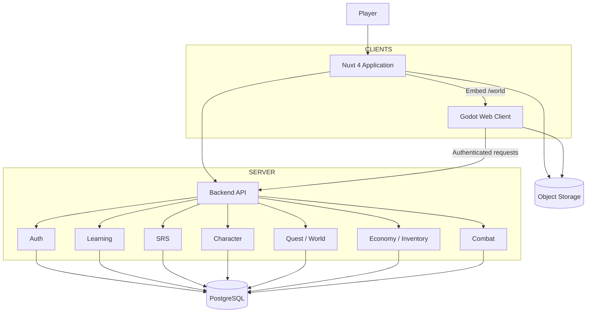

# LinguaWorld — Complete Documentation Bundle


---

# LinguaWorld — Implementation Documentation

**Document package:** 1.2  
**Architecture:** Hybrid Nuxt + Godot  
**Initial curriculum:** Mandarin Chinese — HSK 3.0, with HSK 2.0 as a separate optional curriculum  
**Visual direction:** 2D Cartoon  
**Product principle:** Learning First

## Package contents

- `docs/PRD.md` — Product requirements and scope.
- `docs/GDD.md` — Game design document.
- `docs/ARCHITECTURE.md` — System architecture and technology decisions.
- `docs/API.md` — Initial backend API contract.
- `docs/DATABASE.md` — Data model and database design guidance.
- `docs/GAME_BRIDGE.md` — Nuxt ↔ Godot communication contract.
- `docs/LEARNING_CONTENT.md` — HSK sources, licensing, content schema and import pipeline.
- `docs/ROADMAP.md` — Implementation phases, milestones and acceptance criteria.
- `ANTIGRAVITY_PROMPT.md` — Master implementation prompt for Antigravity.

## Important implementation rules

1. Backend is the source of truth for all persistent state, rewards, progression and validation.
2. Godot is an untrusted presentation/gameplay client. Never trust client-submitted EXP, Gold, damage, quest completion or item ownership.
3. Nuxt owns application UX, learning UX, account management, shop, inventory and administrative interfaces.
4. Godot owns the 2D world presentation, movement, NPC/game scenes, adventure and combat presentation.
5. Learning proficiency and RPG character level are independent.
6. SRS and learning history are first-class product features.
7. Start as a modular monolith. Do not introduce microservices for MVP.
8. HSK 2.0 and HSK 3.0 must be stored as separate curriculum versions.
9. Do not copy copyrighted textbook content, audio or exam material without checking the applicable license and permissions.
10. Validate Godot Web compatibility early on desktop and mobile browsers before investing in large game content.

## Suggested execution order

1. Read all documents.
2. Implement Phase 0 technical prototype only.
3. Demonstrate Nuxt embedding Godot Web, secure communication and authenticated API calls.
4. Obtain approval before proceeding to the next phase.
5. Implement incrementally with tests and updated documentation.

## Current assumptions to confirm during implementation

- Nuxt 4 + Vue 3 + TypeScript.
- PostgreSQL + Prisma.
- Godot 4.x, exact minor version selected and pinned during Phase 0.
- Same-origin deployment for the embedded Godot Web build where practical.
- Secure HttpOnly cookie authentication for Nuxt.
- One initial player/account workflow, but multi-user-ready data ownership.
- Mandarin and Vietnamese as the initial learning language pair.


---

# LinguaWorld — Product Requirements Document

**Version:** 1.2

## 1. Product overview

LinguaWorld is a language-learning platform presented through a friendly 2D cartoon RPG. Players create a personal character, learn Mandarin Chinese, complete learning activities and quests, earn EXP and Gold, customize their character, and explore a game world.

The first use case is personal Mandarin learning. The architecture must be suitable for later public multi-user use and additional language courses.

### Product promise

Learn. Play. Explore. Evolve.

### Core principle

**Learning First:** gameplay must support measurable learning. The product must not become a conventional game with superficial quizzes attached.

## 2. Target users

### Initial user
- A learner studying Mandarin Chinese.
- Wants a more engaging alternative to conventional flashcards and vocabulary apps.
- Enjoys character customization, quests, exploration and collecting items.

### Future users
- Other independent language learners.
- Learners following structured curricula such as HSK.
- Community members who may participate in social and cooperative activities.

## 3. Product pillars

1. Learning First — meaningful language learning is the primary progression driver.
2. Character Progression — create, customize and develop a personal character.
3. Exploration — unlock regions, meet NPCs and complete story quests.
4. Collection — collect outfits, items, furniture and pets.
5. Long-term Retention — SRS, achievements, quests and content expansion.
6. Expandability — support additional users, languages and curricula.

## 4. Core user journey

1. Register or sign in.
2. Create a character.
3. Select a language course and curriculum.
4. Complete a lesson or due SRS reviews.
5. Earn server-validated EXP, Gold and quest progress.
6. Level up the RPG character and customize appearance.
7. Spend Gold on cosmetic items and decorations.
8. Enter the Godot world, explore and interact with NPCs.
9. Complete language-based quests and adventure encounters.
10. Return for scheduled reviews and new content.

## 5. Functional requirements

### 5.1 Authentication and profile
- Register, login, logout and retrieve current user.
- Secure session handling.
- User settings and learning preferences.
- Every user-owned record must be scoped to the authenticated user.

### 5.2 Character
- Create a character.
- Store appearance/customization selections.
- Track RPG level, EXP, HP and reputation.
- Display the character in Nuxt and Godot.
- Character level must not be treated as language proficiency.

### 5.3 Learning
- Course → Unit → Lesson → Activity structure.
- Initial course: Mandarin Chinese.
- Initial curriculum: HSK 3.0 Band 1; HSK 2.0 may be supported as a separate curriculum.
- Support vocabulary, grammar, listening, reading and writing content.
- MVP activity types:
  - Flashcards.
  - Word matching.
  - Quiz.
- Persist learning sessions, answers, accuracy and completion.
- Allow learning content access independently of RPG region unlocks.

### 5.4 Spaced repetition
- Maintain per-user/per-vocabulary scheduling state.
- Store every review attempt.
- Calculate due reviews using a proven algorithm such as FSRS.
- Prioritize overdue vocabulary.
- Measure recall/retention rather than views.
- Keep algorithm version and scheduling parameters traceable.

### 5.5 Economy
- Gold as initial currency.
- EXP and Gold rewards calculated by backend.
- Transaction ledger for every credit/debit.
- Idempotent reward processing.
- Repeated trivial activities must not create unlimited rewards.
- MVP monetization is out of scope.

### 5.6 Inventory and shop
- Item catalog.
- Inventory ownership.
- Purchase and equip/unequip.
- Purchases validated and committed transactionally.
- Cosmetic items are preferred for MVP.
- Equipment must not overpower actual language ability.

### 5.7 Quests
- Learning, daily, weekly, adventure, achievement and seasonal quest types.
- Quest objectives progress from validated backend events.
- NPC story quests may require multiple learning objectives.
- Reward claims must be idempotent.

### 5.8 World and Godot game
- Godot Web export embedded in Nuxt `/world`.
- 2D cartoon world.
- Character movement and animation.
- NPC rendering and interaction.
- World/region state loaded from backend.
- Future: combat, bosses, pets and housing.

### 5.9 Administration and content operations
Future admin functionality:
- Manage curriculum, courses, units, lessons and vocabulary.
- Import CSV/JSON datasets.
- Review translations and examples.
- Manage audio assets and source/license metadata.
- Manage items, quests and rewards.
- Publish/unpublish content.

## 6. Non-functional requirements

- Responsive Nuxt UI.
- Keyboard and touch input support where relevant.
- Accessible learning controls and readable typography.
- Secure authorization on every user-specific API.
- Validate all request payloads.
- Rate-limit sensitive endpoints.
- Log important economy and progression events.
- Database migrations must be reproducible.
- Godot game build and API contract must be versioned.
- Optimize asset size and initial game loading.
- Test real iOS Safari and Android Chrome, not only desktop emulation.

## 7. Product rules

- No punishment for inactivity.
- Pets must not lose health/happiness due to absence.
- No loss of learning progress because a player takes a break.
- Character level and language proficiency are independent.
- SRS reviews and appropriate learning content remain accessible even when regions are locked.
- Backend is authoritative.
- Do not grant rewards solely because a client reports that an activity is complete.

## 8. MVP definition

Must have:
- Authentication.
- Character creation.
- Initial Mandarin vocabulary dataset.
- At least three learning activity types.
- Learning history.
- SRS scheduling.
- EXP and Gold reward processing.
- Inventory and basic shop.
- Godot Web embedded in Nuxt.
- Basic 2D character/world visualization.
- Nuxt ↔ Godot bridge.
- Backend validation for all important rewards.

Should have:
- Daily quests.
- Character animation.
- NPC interaction.
- Basic exploration.
- Achievements.

Out of scope for MVP:
- Real-time multiplayer.
- Guilds and leaderboards.
- Full social network.
- Complex housing simulation.
- Large-scale combat content.
- User-generated curriculum marketplace.
- Payment and premium currency systems.

## 9. Success metrics

North Star Metric: **Weekly Retained Vocabulary** — vocabulary items correctly recalled during the week, measured from review outcomes.

Supporting metrics:
- Weekly Active Learners.
- Lessons Completed.
- SRS Review Completion Rate.
- Vocabulary Retention.
- Learning Accuracy.
- Quest Completion Rate.
- Weekly Return Rate.
- Gold Earned vs Gold Spent.
- World Exploration Rate.

Avoid optimizing solely for login streaks or time spent.


---

# LinguaWorld — Game Design Document

**Version:** 1.2

## 1. Game identity

- Genre: Cozy RPG + Adventure RPG + future Social RPG.
- Visual style: 2D Cartoon, colorful, friendly and approachable.
- Platform: Web first, with Godot Web embedded in Nuxt.
- Core fantasy: learn a language to develop a character, explore a world, help NPCs, collect items and build a personal home.

## 2. Core gameplay loop

Learn → Earn → Grow → Customize → Explore → Quest → Review.

1. Learn new vocabulary or complete an exercise.
2. Earn EXP, Gold and learning progress.
3. Improve character level and unlock cosmetic options.
4. Visit the world and interact with NPCs.
5. Complete language-based quests.
6. Return for SRS reviews.

## 3. Character system

### Appearance
- Body/base type.
- Hair and hairstyle.
- Face and expression.
- Clothing.
- Accessories.
- Equipment appearance.
- Cosmetic sets.

### RPG stats
- Level.
- EXP.
- HP.
- Gold (wallet is managed by economy domain).
- Reputation.
- Equipment.

### Learning proficiency
Track independently:
- Vocabulary.
- Listening.
- Reading.
- Grammar.
- Writing.
- Speaking.

These values must be derived from actual learning performance. Online time, character level or purchased items must not increase language proficiency.

## 4. Learning activities

MVP:
1. Flashcards — recognize Hanzi, Pinyin and meaning.
2. Word Matching — match Hanzi, Pinyin and Vietnamese meaning.
3. Quiz — multiple choice and/or typed response.

Future:
- Listening Quest.
- Grammar Challenge.
- Sentence Builder.
- Word Dungeon.
- Speaking Challenge.
- Writing Challenge.

Learning sessions must be recorded by the backend. Rewards are granted only after validation.

## 5. Quest system

Types:
- Learning Quest.
- Daily Quest.
- Weekly Quest.
- Adventure Quest.
- Achievement.
- Seasonal Event.

Example story quest: **The Lost Translator**
1. NPC asks player to decode a letter.
2. Player learns five target vocabulary words.
3. Player completes a sentence translation activity.
4. Player completes a listening challenge.
5. Player returns to NPC.
6. Backend verifies all objectives and grants rewards.

Quest definitions should be data-driven, not hardcoded into individual scenes.

## 6. World and regions

Suggested thematic progression:

| Region | Suggested curriculum association |
|---|---|
| Beginner Village | HSK 1 |
| Whispering Forest | HSK 2 |
| Crystal Lake | HSK 3 |
| Ancient City | HSK 4 |
| Dragon Mountain | HSK 5 |
| Celestial Kingdom | HSK 6 |

This is thematic guidance, not a hard learning restriction. Learners must be able to access lessons and due reviews appropriate to their actual learning needs.

Because HSK 3.0 uses nine levels, region-to-level mapping must be configurable rather than hardcoded to six regions.

## 7. Adventure and combat

Combat is turn-based and language-driven.

Flow:
1. Backend creates a combat session.
2. Godot renders encounter and question.
3. Player submits an answer.
4. Backend evaluates the answer.
5. Backend updates combat state.
6. Godot displays the result and animation.
7. Backend validates completion and grants reward.

Rules:
- Correct answer: attack.
- Incorrect answer: lose turn or receive damage.
- Consecutive correct answers: combo.
- Boss encounters: multiple stages/questions.
- Equipment bonuses must remain small.
- Client must never decide authoritative damage, answer correctness or rewards.

## 8. Housing and pets

Future features:
- Personal home.
- Furniture and decoration.
- Room themes.
- Garden.
- Pet collection.
- Pet customization.
- Pet accessories and interactions.

No inactivity punishment. Pets must not lose health, happiness or items because the player is away.

## 9. Economy

Primary currency: Gold. Gems may be considered later, but are not required for MVP.

Gold sources:
- Validated lesson completion.
- Learning quests.
- Daily quests.
- Achievements.
- Validated adventure completion.

Gold sinks:
- Cosmetics.
- Furniture.
- Pet accessories.
- Character customization.
- Limited non-essential equipment.

Economy rules:
- Every transaction is recorded.
- Use idempotency keys for reward claims.
- Prevent duplicate completion and replay abuse.
- Apply reasonable reward caps/cooldowns.
- Do not make purchased equipment a substitute for knowledge.

## 10. UI/UX direction

Nuxt:
- Home prioritizes character, next learning task and due reviews.
- Learning pages prioritize focus and clarity.
- Shop and inventory are standard application screens.
- World route provides a full-screen game experience.

Godot:
- Game world, movement, NPCs and adventure scenes.
- Avoid duplicating account management and complex learning administration in Godot.
- Use loading and error states when game assets or API are unavailable.

## 11. Content principles

- Data-driven lessons, quests and item definitions.
- Store source and license metadata for learning materials.
- Separate curriculum versions.
- Avoid hardcoding HSK level assumptions into gameplay code.
- Use reusable activity templates.


---

# LinguaWorld — Technical Architecture

**Version:** 1.2  
**Decision:** Hybrid Nuxt + Godot, backend-authoritative modular monolith.

## 1. Technology baseline

| Layer | Choice |
|---|---|
| Web application | Nuxt 4 + Vue 3 + TypeScript |
| Styling | Tailwind CSS |
| Game engine | Godot 4.x |
| Backend | Nuxt Server API initially |
| Database | PostgreSQL |
| ORM | Prisma |
| Authentication | Secure HttpOnly cookie-based session |
| Asset storage | S3-compatible object storage |
| Audio in web | HTML Audio API |
| Audio in game | Godot audio |
| Animation | CSS/Lottie/Godot AnimationPlayer |

Pin exact versions during Phase 0 and record them in the repository. Do not silently upgrade engine/runtime versions after content production begins.

## 2. Responsibility boundaries

### Nuxt owns
- Authentication and account.
- Home/dashboard.
- Learning courses, lessons and exercises.
- Flashcards, matching and quiz.
- Learning history and SRS UI.
- Character management UI.
- Inventory and shop UI.
- Quest overview and profile.
- Admin/CMS in later phase.
- Hosting/embedding the Godot Web build.

### Godot owns
- 2D world rendering.
- Character rendering and animation.
- Movement and camera.
- NPC visualization and in-world interaction.
- Exploration.
- Adventure and combat presentation.
- Pet and housing visualization in later phases.

### Backend owns
- Authentication and authorization.
- Persistent user data.
- Learning evaluation and history.
- SRS scheduling.
- Character progression.
- Inventory and wallet.
- Quest validation.
- World unlocks.
- Combat state and reward validation.

Godot must not connect directly to PostgreSQL.

## 3. High-level diagram



## 4. Routing

- `/` — landing.
- `/home` — dashboard.
- `/learn` — learning overview.
- `/learn/courses` — course selection.
- `/learn/lesson/:id` — lesson.
- `/review` — SRS.
- `/character` — character management.
- `/inventory` — inventory.
- `/shop` — shop.
- `/quests` — quest overview.
- `/world` — full-screen Godot game.
- `/profile` — player profile.

## 5. Godot Web integration

Recommended MVP: export Godot to Web and embed in Nuxt `/world`.

Keep the game build on the same origin as Nuxt where practical. This reduces authentication complexity and avoids unnecessary cross-origin configuration.

Potential static output:
- `index.html`
- generated JavaScript loader
- `.wasm`
- `.pck`
- game assets

Do not assume the exact output filenames; use the selected Godot version's export template.

Use an isolated bridge adapter. Do not scatter browser JavaScript calls through gameplay scripts.

## 6. Authentication

Preferred MVP:
- Nuxt handles login.
- Use secure HttpOnly cookies.
- Same-origin game API requests where supported.
- Backend authenticates every API request.

If game hosting becomes cross-origin:
- Backend issues short-lived, single-use game ticket.
- Exchange ticket for a narrowly scoped game session.
- Never place long-lived access tokens in query strings or localStorage.
- Validate origin and audience.
- Expire/revoke tickets.

## 7. Backend organization

Modular monolith:

```text
apps/web/
  app/
  components/
  pages/
  composables/
  server/
    api/
    modules/
      auth/
      users/
      learning/
      vocabulary/
      srs/
      character/
      inventory/
      economy/
      quests/
      world/
      combat/
      achievements/
```

Each module should expose application services and own its domain rules. Avoid direct cross-module database writes.

## 8. Suggested monorepo

```text
linguaworld/
├── apps/
│   ├── web/
│   └── game/
├── packages/
│   ├── api-contracts/
│   └── shared-types/
├── database/
│   └── prisma/
├── content/
│   ├── imports/
│   ├── normalized/
│   └── reviewed/
├── docs/
└── README.md
```

## 9. Deployment

MVP:
- Deploy Nuxt application and API.
- Serve Godot Web export as static assets under same origin if feasible.
- PostgreSQL managed or self-hosted.
- S3-compatible storage for audio and images.
- Use CDN/cache for static game assets.

Separate game deployment/subdomain only if needed for performance or operational reasons.

## 10. Architecture constraints

- No microservices in MVP.
- No direct database access from Godot.
- No client-authoritative rewards.
- No secrets in client bundles.
- Version API contracts and game bridge.
- Keep curriculum content data-driven.
- Make all user-owned records user-scoped.
- Use database transactions for wallet, purchases and reward claims.


---

# LinguaWorld — Initial API Contract

**Version:** 1.0 draft

All endpoints require authentication unless explicitly marked public. Validate input schemas, authorize user ownership and return consistent error envelopes.

## 1. Response conventions

Success:
```json
{
  "data": {},
  "meta": {
    "requestId": "req_example"
  }
}
```

Error:
```json
{
  "error": {
    "code": "VALIDATION_ERROR",
    "message": "The request is invalid.",
    "details": []
  },
  "meta": {
    "requestId": "req_example"
  }
}
```

Never return stack traces or internal secrets to clients.

## 2. Authentication

- `POST /api/auth/register`
- `POST /api/auth/login`
- `POST /api/auth/logout`
- `GET /api/auth/me`

## 3. Learning

- `GET /api/learning/courses`
- `GET /api/learning/courses/:courseId`
- `GET /api/learning/lessons/:lessonId`
- `POST /api/learning/sessions`
- `GET /api/learning/sessions/:sessionId`
- `POST /api/learning/sessions/:sessionId/answers`
- `POST /api/learning/sessions/:sessionId/complete`

The server must determine whether the session is valid and whether completion criteria are satisfied.

## 4. SRS

- `GET /api/srs/due`
- `POST /api/srs/reviews`
- `GET /api/srs/statistics`

A review submission should include vocabulary ID, answer/result data and response time where appropriate. The backend calculates rating/scheduling state according to the chosen SRS algorithm. Do not accept client-calculated due dates as authoritative.

## 5. Character

- `GET /api/character`
- `POST /api/character`
- `PATCH /api/character/appearance`
- `GET /api/character/progression`

## 6. Inventory and shop

- `GET /api/inventory`
- `POST /api/inventory/equip`
- `POST /api/inventory/unequip`
- `GET /api/shop/items`
- `POST /api/shop/purchase`

Purchase payload should contain item ID, quantity if supported, and an idempotency key. Price must be read from server-side catalog, not trusted from client.

## 7. Economy

- `GET /api/wallet`
- `GET /api/wallet/transactions`

Reward crediting should normally be an internal domain operation triggered by validated completion events, not a public endpoint accepting arbitrary EXP/Gold.

## 8. Quests

- `GET /api/quests`
- `GET /api/quests/:questId`
- `POST /api/quests/:questId/claim`

Quest progress should be derived from validated domain events. Claim endpoint must verify all objectives and use an idempotency key or unique reward constraint.

## 9. World

- `GET /api/world/state`
- `GET /api/world/regions`
- `POST /api/world/interactions`

Interaction requests should include a known interaction/NPC ID and context. Backend validates whether the player can perform the interaction.

## 10. Combat

- `POST /api/combat/sessions`
- `GET /api/combat/sessions/:sessionId`
- `POST /api/combat/sessions/:sessionId/actions`
- `POST /api/combat/sessions/:sessionId/complete`

Backend owns:
- Session lifecycle.
- Question selection.
- Answer evaluation.
- Enemy/player state.
- Damage calculation.
- Completion state.
- Rewards.

Godot sends player actions and renders server results.

## 11. Security requirements

- Authenticate and authorize every private endpoint.
- Validate ownership of session, quest, item and character IDs.
- Rate-limit login, answer and reward-sensitive operations.
- Use CSRF protection appropriate to cookie authentication.
- Validate idempotency keys.
- Use transactions for purchases and reward grants.
- Never accept arbitrary Gold, EXP, damage or completion flags.


---

# LinguaWorld — Database Design

**Version:** 1.0 draft  
**Database:** PostgreSQL  
**ORM:** Prisma

This is a domain-oriented starting point. Final Prisma schema should be normalized and reviewed before implementation.

## 1. Domains and suggested tables

### User
- `users`
- `user_settings`
- `sessions` (if using database-backed sessions)

### Character
- `characters`
- `character_stats`
- `character_appearances`

### Curriculum and learning
- `curriculums`
- `curriculum_levels`
- `courses`
- `units`
- `lessons`
- `vocabulary`
- `vocabulary_meanings`
- `vocabulary_readings`
- `vocabulary_examples`
- `vocabulary_audio`
- `grammar_points`
- `exercises`
- `questions`
- `question_options`

### Learning history and SRS
- `learning_sessions`
- `learning_answers`
- `vocabulary_progress`
- `review_history`

### Economy and inventory
- `items`
- `wallets`
- `wallet_transactions`
- `inventory`
- `equipment`

### Quest and world
- `quests`
- `quest_objectives`
- `quest_progress`
- `regions`
- `locations`
- `world_unlocks`

### Combat
- `combat_sessions`
- `combat_actions`

### Pets/housing (later)
- `pet_definitions`
- `user_pets`
- `houses`
- `decorations`
- `house_decorations`

### Achievement
- `achievements`
- `user_achievements`

## 2. Important relationships

- Every user-owned row has `user_id`.
- A curriculum has version and source metadata.
- A curriculum level belongs to a curriculum, not globally to the vocabulary table.
- Vocabulary is a reusable language item; curriculum membership should be represented through a join/mapping where needed.
- A vocabulary item may appear in more than one curriculum or level.
- Learning answers belong to a learning session.
- SRS state is per user and vocabulary item.
- Wallet transactions are immutable ledger entries.
- Inventory ownership references item definitions.
- Quest progress is per user and quest.
- Combat actions belong to a server-created combat session.

## 3. Key fields

### curriculums
- `id`
- `code` (e.g. `hsk-3.0`)
- `name`
- `version`
- `language_code`
- `translation_language_code`
- `source_url`
- `license_name`
- `license_url`
- `status`
- `created_at`

### vocabulary
- `id`
- `language_code`
- `hanzi`
- `simplified`
- `traditional`
- `created_at`

### vocabulary_readings
- `id`
- `vocabulary_id`
- `reading`
- `reading_system` (e.g. pinyin)
- `is_primary`

### vocabulary_meanings
- `id`
- `vocabulary_id`
- `language_code`
- `meaning`
- `part_of_speech`
- `review_status`
- `source_id`

### curriculum_vocabulary
- `curriculum_level_id`
- `vocabulary_id`
- `sequence_number`
- `source_reference`

### vocabulary_progress
- `id`
- `user_id`
- `vocabulary_id`
- `state`
- `difficulty`
- `stability`
- `due_at`
- `last_reviewed_at`
- `total_reviews`
- `correct_reviews`
- `incorrect_reviews`
- `algorithm_version`

### review_history
- `id`
- `user_id`
- `vocabulary_id`
- `answer`
- `rating`
- `response_time_ms`
- `reviewed_at`
- `session_id`

### wallet_transactions
- `id`
- `user_id`
- `currency`
- `amount` (signed or explicit direction; choose one convention)
- `transaction_type`
- `reference_type`
- `reference_id`
- `idempotency_key`
- `created_at`

## 4. Constraints and indexes

- Unique user email/username as appropriate.
- Unique `(user_id, vocabulary_id)` for current SRS state.
- Unique idempotency key within the relevant user/domain.
- Unique inventory ownership row by `(user_id, item_id)` if quantity-based.
- Index user-owned tables by `(user_id, created_at)`.
- Index due reviews by `(user_id, due_at)`.
- Index curriculum vocabulary by `(curriculum_level_id, sequence_number)`.
- Foreign keys for all domain relationships.
- Use check constraints for nonnegative quantities/balances where applicable.

## 5. Transaction requirements

Purchase transaction:
1. Lock/read wallet safely.
2. Validate item availability and price on server.
3. Validate sufficient balance.
4. Debit wallet.
5. Create inventory ownership/quantity.
6. Write ledger transaction.
7. Commit atomically.

Reward transaction:
1. Validate originating learning/quest/combat event.
2. Check idempotency/unique reward claim.
3. Calculate reward server-side.
4. Credit wallet and/or EXP.
5. Write ledger/event record.
6. Commit atomically.

Never update wallet balance without a corresponding ledger entry.

## 6. Content provenance

Store source and license information for imported learning content. Avoid mixing data with different licensing conditions into an untraceable dataset.


---

# LinguaWorld — Nuxt ↔ Godot Game Bridge

**Version:** 1.0 draft

## 1. Purpose

Define a small, versioned communication protocol between the Nuxt parent application and embedded Godot Web client.

The bridge is for UI coordination and gameplay requests. It is not a security boundary and does not make the game client trusted.

## 2. Message envelope

```json
{
  "version": 1,
  "type": "INTERACT_NPC",
  "requestId": "req_123",
  "payload": {
    "npcId": "npc_001"
  }
}
```

Fields:
- `version`: protocol version.
- `type`: allowlisted event name.
- `requestId`: optional correlation ID.
- `payload`: event-specific validated data.

## 3. Initial event catalogue

### Nuxt → Godot
- `GAME_INIT`: initial boot information and non-secret configuration.
- `PLAYER_DATA`: current character appearance and display stats.
- `WORLD_DATA`: visible regions and world configuration.
- `SET_AUDIO`: application-level audio preference.
- `PAUSE_GAME`: pause game.
- `RESUME_GAME`: resume game.

### Godot → Nuxt
- `GAME_READY`: Godot initialization completed.
- `GAME_ERROR`: client-side failure.
- `INTERACT_NPC`: request interaction with NPC.
- `ENTER_REGION`: request entry to a region.
- `START_COMBAT`: request creation of combat session.
- `OPEN_APP_ROUTE`: request Nuxt to open a permitted application route.

## 4. Example NPC interaction

Godot → Nuxt:
```json
{
  "version": 1,
  "type": "INTERACT_NPC",
  "requestId": "req_123",
  "payload": {
    "npcId": "npc_001"
  }
}
```

Nuxt calls backend:
`POST /api/world/interactions`

Backend validates:
- Authenticated user.
- NPC exists and is active.
- Player can access the location.
- Interaction prerequisites.
- Quest state.

Nuxt returns result to Godot through a correlated response/event. The response contains displayable dialogue/quest state, not arbitrary client-authoritative rewards.

## 5. Security

- Validate exact `event.origin` in the parent window.
- Validate `event.source` matches the expected iframe/window.
- Validate message envelope and payload schema.
- Allowlist event types.
- Ignore unknown protocol versions.
- Never accept EXP, Gold, item ownership, answer correctness, damage or quest completion from client as authoritative.
- Never put secrets in bridge messages.
- Avoid passing long-lived tokens.
- Restrict `OPEN_APP_ROUTE` to approved internal routes.
- Use request IDs and timeout/error handling.

## 6. Lifecycle

1. Nuxt renders loading state and game iframe/container.
2. Godot initializes.
3. Godot sends `GAME_READY`.
4. Nuxt sends `GAME_INIT`, then player/world data.
5. Godot requests actions.
6. Nuxt/backend validate actions and send results.
7. On route leave, Nuxt sends pause/cleanup where possible.
8. On errors, show recoverable UI and provide retry.

## 7. Performance and compatibility

- Load the game only when `/world` is visited.
- Show progress/loading UI.
- Avoid loading large unused assets at boot.
- Test browser audio activation requirements.
- Test memory and WebGL behavior on actual target devices.
- Test mobile touch controls and viewport resizing.


---

# LinguaWorld — Learning Content and HSK Data Strategy

**Version:** 1.0

## 1. Curriculum decision

Use **HSK 3.0 as the primary new curriculum**, while optionally supporting HSK 2.0 as a separate curriculum for learners using older books or exam materials.

Do not merge HSK 2.0 and HSK 3.0 into a single level list. They are distinct curriculum versions with different structures and vocabulary coverage.

HSK 3.0 has nine levels grouped into three bands. The data model must be configurable and must not hardcode a six-level assumption.

## 2. Candidate sources

These are discovery starting points. Before importing or redistributing, inspect the current repository, source provenance, exact license and any upstream content restrictions.

### Official Chinese Test resource portal
- https://admin.chinesetest.cn/godownload.do
- Use as a reference for official syllabus, sample tests and associated learning/exam resources.
- Official availability does not automatically grant permission to redistribute all materials.

### HSK 3.0 vocabulary dataset
- https://github.com/uranbekanarbaev/hsk-3.0-vocabulary-dataset
- Candidate structured vocabulary source (CSV/JSON/PDF formats may be available).
- Verify the exact version, source attribution and LICENSE file before use.

### HSK 3.0 structured dataset
- https://github.com/profesorm/hsk30
- Candidate source for vocabulary and related language-learning structures.
- Verify repository license and upstream source attribution before commercial use.

### HSK Studio syllabus resource
- https://hsk-studio.com/vi/resources/syllabus
- Useful as a discovery/reference source for HSK 3.0 syllabus documents.
- Check document provenance and permissions before copying or redistributing.

## 3. Recommended content strategy

Use datasets for initial vocabulary structure, then enrich and review content.

| Content | Recommended source/process |
|---|---|
| Hanzi and HSK level | Syllabus/dataset, cross-checked |
| Pinyin | Dataset plus validation |
| Vietnamese meaning | Translate and human-review |
| Part of speech | Dataset plus editorial review |
| Example sentences | Original writing or licensed source |
| Audio | Licensed recording or generated TTS with appropriate rights |
| Grammar explanations | Original editorial content or licensed resources |
| Exercises | Generate from approved content and review |
| Stroke order | Licensed/open dataset with attribution |

Do not scrape commercial textbooks, paid apps or copyrighted audio without permission.

## 4. Data import pipeline

```text
Source files
   ↓
Raw import (immutable)
   ↓
Parser
   ↓
Normalization
   ↓
Schema validation
   ↓
Duplicate detection
   ↓
Vietnamese enrichment
   ↓
Editorial review
   ↓
Approved content
   ↓
Database publish
```

Keep raw source files and import logs for traceability. Every imported record should retain source and license metadata.

## 5. Suggested vocabulary model

A vocabulary item should not be represented by only one `word + meaning` pair.

Suggested logical fields:
- Hanzi (simplified/traditional where relevant).
- Pinyin.
- Vietnamese meaning(s).
- Part of speech.
- HSK curriculum/version and level membership.
- Topic/tags.
- Example sentences.
- Audio references.
- Notes.
- Source/provenance.
- Review status.

A word may appear in multiple curricula or levels. Model curriculum membership as a relation, not a single hardcoded level field on the vocabulary record.

## 6. Example content record

Illustrative only; verify level assignment against the selected syllabus before publishing:

```json
{
  "hanzi": "学习",
  "pinyin": "xuéxí",
  "meanings": [
    {
      "language": "vi",
      "text": "học; học tập"
    }
  ],
  "partOfSpeech": ["verb"],
  "examples": [
    {
      "hanzi": "我每天学习中文。",
      "pinyin": "Wǒ měitiān xuéxí Zhōngwén.",
      "translation": "Tôi học tiếng Trung mỗi ngày."
    }
  ],
  "audio": [],
  "curriculumMemberships": [],
  "source": {
    "name": "to be recorded",
    "url": "to be recorded",
    "license": "to be verified"
  },
  "reviewStatus": "draft"
}
```

## 7. MVP content target

Start with:
- One curriculum: HSK 3.0.
- Band 1 initial scope.
- First 100–300 vocabulary entries.
- Vietnamese meanings.
- Pinyin.
- Original example sentences.
- Audio for priority vocabulary.
- Three activity templates: flashcard, matching and quiz.

Do not import the entire HSK 3.0 corpus before the import/validation workflow is proven.

## 8. Content quality checklist

- [ ] Hanzi normalized.
- [ ] Pinyin validated.
- [ ] Meaning is natural Vietnamese.
- [ ] Part of speech reviewed.
- [ ] Curriculum version and level verified.
- [ ] Example sentence is grammatically correct.
- [ ] Translation reviewed.
- [ ] Audio pronunciation checked.
- [ ] Source and license recorded.
- [ ] No unlicensed textbook/exam content copied.
- [ ] Duplicate entries resolved.
- [ ] Content status approved before learner publication.


---

# LinguaWorld — Implementation Roadmap

**Version:** 1.2

## Delivery strategy

Build in vertical slices. Complete and verify the smallest end-to-end capability before expanding scope.

## Phase 0 — Technical validation

Goal: prove Nuxt + Godot Web integration.

Tasks:
- Create monorepo.
- Initialize Nuxt 4, TypeScript and Tailwind.
- Initialize Godot 4.x project and pin version.
- Create one simple scene with a controllable placeholder character.
- Export Godot Web.
- Serve/embed build in Nuxt `/world`.
- Implement versioned bridge.
- Send `GAME_READY` and `INTERACT_NPC` events.
- Add a simple authenticated API endpoint and fetch it from game context.
- Test desktop Chrome, iOS Safari and Android Chrome.
- Record performance, audio, memory and WebGL findings.

Acceptance:
- `/world` loads the embedded game.
- Character can move.
- Nuxt sends initialization data.
- Godot sends an event to Nuxt.
- Backend request is authenticated and validated.
- Loading and failure states work.
- Compatibility findings are documented.

Do not proceed to large asset production until this phase passes.

## Phase 1 — Learning core

Tasks:
- Authentication.
- User settings.
- Character creation.
- Curriculum/course/unit/lesson management.
- Vocabulary import pipeline.
- HSK 3.0 initial dataset.
- Flashcards.
- Word matching.
- Quiz.
- Learning sessions and answer history.
- SRS integration (FSRS or another evaluated algorithm).
- EXP and Gold server-side reward rules.
- Learning dashboard.

Acceptance:
- User can create a character.
- At least 100 reviewed vocabulary entries are available.
- Three learning activity types work.
- Learning history persists.
- Due reviews are calculated server-side.
- Rewards are granted once after valid completion.
- Learning proficiency is independent of RPG level.

## Phase 2 — RPG foundation

Tasks:
- Character appearance and customization.
- Item catalog.
- Inventory.
- Wallet ledger.
- Shop and transactional purchase.
- Equip/unequip.
- Daily quests.
- Achievements.
- Godot character rendering and animation.
- Basic environment and movement.
- NPC rendering and interaction.
- Sync character appearance into game.

Acceptance:
- Player can purchase and equip an item.
- Inventory and wallet are correct after refresh.
- Godot renders the server-owned appearance.
- Quest progress comes from validated events.

## Phase 3 — Adventure world

Tasks:
- Regions and map.
- NPC dialogue.
- Adventure quests.
- World unlock validation.
- Combat sessions.
- Question/answer combat loop.
- Boss encounter prototype.
- Combat result synchronization.
- Reward validation.

Acceptance:
- Player explores an unlocked region.
- NPC can start a quest.
- Quest objectives update from learning events.
- Combat answer is evaluated by backend.
- Client cannot forge completion or rewards.

## Phase 4 — Retention and content

Tasks:
- More curriculum content.
- More vocabulary and grammar.
- Listening activities.
- More regions and quests.
- SRS analytics.
- Pet and housing prototype.
- Seasonal events.
- UX and performance improvements.

## Phase 5 — Public platform expansion

Tasks:
- Public multi-user hardening.
- Profile visibility controls.
- Friends and social systems.
- Leaderboards.
- Guilds and shared events.
- Admin CMS.
- Multiple languages/curricula.
- Content moderation and reporting.

## Suggested first sprint backlog

1. Create repository and app/game folders.
2. Build Nuxt shell and `/world` route.
3. Build Godot placeholder scene.
4. Export and embed.
5. Implement bridge envelope and event allowlist.
6. Add `/api/game/bootstrap` (authenticated).
7. Load placeholder character data into Godot.
8. Test browsers and document limitations.

## Definition of Done

A feature is done only when:
- Requirements are implemented.
- Server-side validation exists where required.
- Authorization is tested.
- Error/loading states exist.
- Relevant automated tests pass.
- Database migrations and seed data are included.
- Documentation is updated.
- No secrets or trusted reward values are exposed to the client.


---

# Master Prompt — Implement LinguaWorld

You are the senior product engineer and technical lead responsible for implementing LinguaWorld from the documentation in this repository.

## First: read before coding

Read all of:
- `README.md`
- `docs/PRD.md`
- `docs/GDD.md`
- `docs/ARCHITECTURE.md`
- `docs/API.md`
- `docs/DATABASE.md`
- `docs/GAME_BRIDGE.md`
- `docs/LEARNING_CONTENT.md`
- `docs/ROADMAP.md`

Treat these documents as the current product and architecture baseline. If documents conflict, prioritize:
1. Security and data integrity rules.
2. Architecture decisions.
3. PRD functional requirements.
4. GDD gameplay details.
5. Roadmap sequencing.

Do not silently make major product or architecture changes. Record questions and proposed changes in `docs/DECISIONS.md`.

## Product summary

LinguaWorld is a Mandarin-learning platform with a 2D cartoon RPG experience.

Approved architecture:
- Nuxt 4 + Vue 3 + TypeScript for the application and learning platform.
- Godot 4.x for the embedded 2D game client.
- PostgreSQL + Prisma.
- Nuxt Server API as the initial modular-monolith backend.
- Godot Web export embedded in Nuxt `/world`.
- Backend is the source of truth.

Nuxt owns authentication, learning, SRS UI, character management, inventory, shop, quests overview and profile. Godot owns world rendering, movement, NPC/game presentation, exploration and future combat. Backend owns all persistent state, validation, rewards and economy.

## Non-negotiable rules

1. Never let Godot connect directly to PostgreSQL.
2. Never trust client-submitted EXP, Gold, damage, answer correctness, item ownership or quest completion.
3. Backend calculates and validates all rewards.
4. Use transactions for wallet, purchase and reward operations.
5. Use idempotency/unique constraints to prevent duplicate rewards.
6. Character level and language proficiency must be separate.
7. Learning history and SRS are first-class features.
8. No inactivity punishment for pets or player progress.
9. Learning content must remain accessible regardless of RPG region unlocks.
10. HSK 2.0 and HSK 3.0 are separate curricula.
11. Record source and license metadata for imported content.
12. Do not copy copyrighted books, paid course content, exam content or audio without appropriate rights.
13. Use a modular monolith. Do not introduce microservices for MVP.
14. Do not build all game systems at once.
15. Keep API and bridge contracts versioned and validated.

## Execution mode

Work in phases. Do not attempt to implement the entire product in one pass.

### Phase 0 — Technical prototype only

Implement:
- Monorepo skeleton.
- Nuxt application shell.
- `/world` route.
- Minimal Godot project with a placeholder character and movement.
- Godot Web export.
- Embedding in Nuxt.
- Versioned Nuxt ↔ Godot message bridge.
- Authenticated backend bootstrap endpoint.
- Basic loading/error UI.
- Browser compatibility test notes.

Acceptance:
- Game loads inside `/world`.
- Character can move.
- Nuxt sends initialization data.
- Godot sends a validated event.
- Game can retrieve bootstrap data from backend.
- No secret is exposed to client.
- Test desktop Chrome and, where devices are available, iOS Safari and Android Chrome.

Do not build learning, inventory, combat or a large world during Phase 0.

At the end:
- Run available checks.
- Summarize files created and decisions.
- Report browser/platform limitations.
- Update docs with actual implementation details.
- Stop and ask for approval before Phase 1.

### Phase 1 — Learning core

Only begin after Phase 0 approval. Implement authentication, curriculum structures, initial HSK content import pipeline, vocabulary, three activity types, learning history, SRS and server-authoritative rewards.

### Phase 2 — RPG foundation

Only begin after Phase 1 approval. Implement character customization, item catalog, inventory, shop, wallet ledger, daily quests, achievements and Godot character/world synchronization.

### Phase 3 — Adventure

Only begin after Phase 2 approval. Implement NPC interactions, regions, quests, combat sessions and backend-validated rewards.

### Phase 4/5

Implement retention, content expansion and public platform features only after the earlier phases are stable.

## Engineering standards

- TypeScript strict mode where feasible.
- Validate API inputs with a consistent schema-validation library.
- Keep domain rules out of Vue components and Godot scene scripts.
- Use services/use-cases for application logic.
- Use Prisma migrations; do not rely on ad-hoc production schema changes.
- Add tests for auth, ownership, reward idempotency, purchases and SRS scheduling.
- Include seed scripts with clearly identified sample data.
- Keep secrets in environment variables and provide `.env.example` without real secrets.
- Add structured logging for important operations.
- Handle loading, empty, error and retry states.
- Keep UI responsive.
- Pin runtime and engine versions.
- Avoid unnecessary dependencies.

## Required output at the end of each phase

1. Summary of implemented functionality.
2. Architecture decisions made.
3. Files and modules created/changed.
4. Database migrations and seed data.
5. Commands to install, run, test and build.
6. Verification results.
7. Known issues and risks.
8. Updated documentation.
9. Explicit list of what is not implemented.
10. Stop for approval before moving to the next phase.

Start by inspecting the repository and reading the documents. Then implement Phase 0 only.
