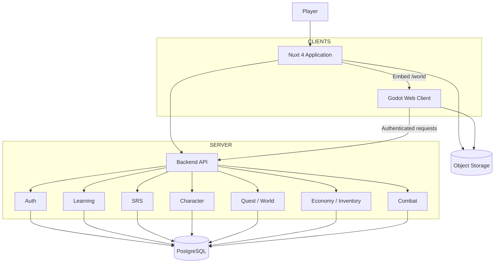

# LinguaWorld — Technical Architecture

**Version:** 1.2  
**Decision:** Hybrid Nuxt + Godot, backend-authoritative modular monolith.

## 1. Technology baseline

| Layer | Choice |
|---|---|
| Web application | Nuxt 4 + Vue 3 + TypeScript |
| Styling | Tailwind CSS |
| Game engine | Godot 4.x |
| Backend | Nuxt Server API initially |
| Database | PostgreSQL |
| ORM | Prisma |
| Authentication | Secure HttpOnly cookie-based session |
| Asset storage | S3-compatible object storage |
| Audio in web | HTML Audio API |
| Audio in game | Godot audio |
| Animation | CSS/Lottie/Godot AnimationPlayer |

Pin exact versions during Phase 0 and record them in the repository. Do not silently upgrade engine/runtime versions after content production begins.

## 2. Responsibility boundaries

### Nuxt owns
- Authentication and account.
- Home/dashboard.
- Learning courses, lessons and exercises.
- Flashcards, matching and quiz.
- Learning history and SRS UI.
- Character management UI.
- Inventory and shop UI.
- Quest overview and profile.
- Admin/CMS in later phase.
- Hosting/embedding the Godot Web build.

### Godot owns
- 2D world rendering.
- Character rendering and animation.
- Movement and camera.
- NPC visualization and in-world interaction.
- Exploration.
- Adventure and combat presentation.
- Pet and housing visualization in later phases.

### Backend owns
- Authentication and authorization.
- Persistent user data.
- Learning evaluation and history.
- SRS scheduling.
- Character progression.
- Inventory and wallet.
- Quest validation.
- World unlocks.
- Combat state and reward validation.

Godot must not connect directly to PostgreSQL.

## 3. High-level diagram



## 4. Routing

- `/` — landing.
- `/home` — dashboard.
- `/learn` — learning overview.
- `/learn/courses` — course selection.
- `/learn/lesson/:id` — lesson.
- `/review` — SRS.
- `/character` — character management.
- `/inventory` — inventory.
- `/shop` — shop.
- `/quests` — quest overview.
- `/world` — full-screen Godot game.
- `/profile` — player profile.

## 5. Godot Web integration

Recommended MVP: export Godot to Web and embed in Nuxt `/world`.

Keep the game build on the same origin as Nuxt where practical. This reduces authentication complexity and avoids unnecessary cross-origin configuration.

Potential static output:
- `index.html`
- generated JavaScript loader
- `.wasm`
- `.pck`
- game assets

Do not assume the exact output filenames; use the selected Godot version's export template.

Use an isolated bridge adapter. Do not scatter browser JavaScript calls through gameplay scripts.

## 6. Authentication

Preferred MVP:
- Nuxt handles login.
- Use secure HttpOnly cookies.
- Same-origin game API requests where supported.
- Backend authenticates every API request.

If game hosting becomes cross-origin:
- Backend issues short-lived, single-use game ticket.
- Exchange ticket for a narrowly scoped game session.
- Never place long-lived access tokens in query strings or localStorage.
- Validate origin and audience.
- Expire/revoke tickets.

## 7. Backend organization

Modular monolith:

```text
apps/web/
  app/
  components/
  pages/
  composables/
  server/
    api/
    modules/
      auth/
      users/
      learning/
      vocabulary/
      srs/
      character/
      inventory/
      economy/
      quests/
      world/
      combat/
      achievements/
```

Each module should expose application services and own its domain rules. Avoid direct cross-module database writes.

## 8. Suggested monorepo

```text
linguaworld/
├── apps/
│   ├── web/
│   └── game/
├── packages/
│   ├── api-contracts/
│   └── shared-types/
├── database/
│   └── prisma/
├── content/
│   ├── imports/
│   ├── normalized/
│   └── reviewed/
├── docs/
└── README.md
```

## 9. Deployment

MVP:
- Deploy Nuxt application and API.
- Serve Godot Web export as static assets under same origin if feasible.
- PostgreSQL managed or self-hosted.
- S3-compatible storage for audio and images.
- Use CDN/cache for static game assets.

Separate game deployment/subdomain only if needed for performance or operational reasons.

## 10. Architecture constraints

- No microservices in MVP.
- No direct database access from Godot.
- No client-authoritative rewards.
- No secrets in client bundles.
- Version API contracts and game bridge.
- Keep curriculum content data-driven.
- Make all user-owned records user-scoped.
- Use database transactions for wallet, purchases and reward claims.
