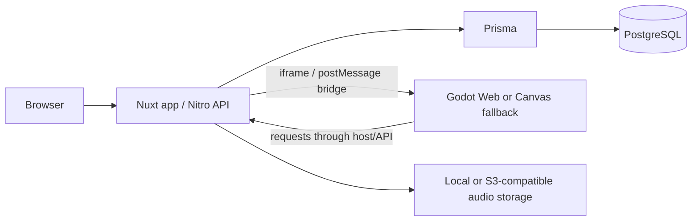

# LinguaWorld architecture

**Status:** Current implementation map inspected on 2026-11-04. This file explains the code that exists; aspirational product direction belongs in `PRD.md`, `GDD.md`, and `ROADMAP.md`.

## Technology baseline

| Area | Current repository choice |
| --- | --- |
| Web + server | Nuxt 3.14.1592 with Nuxt 4 compatibility conventions, Vue 3, TypeScript, Nitro |
| Styling/UI | Tailwind CSS; design references in `UX-UI.md` and `design-system/linguaworld/MASTER.md` |
| Game | Godot 4.6, GL Compatibility renderer; Canvas browser fallback at `apps/web/public/game/` |
| Data | Prisma 6.1, PostgreSQL datasource |
| Shared contracts | npm workspaces: `packages/shared-types`, `packages/api-contracts` |
| Monorepo | npm workspaces and Turborepo |

Confirm pinned versions in package manifests and `apps/game/project.godot` before changing the baseline.

## Runtime ownership

- **Nuxt application (`apps/web/app`)** owns pages, learning and character interfaces, shop/inventory/quest views, locale handling, and the embedded game route.
- **Nitro server (`apps/web/server`)** owns API handlers, session resolution, persistence through Prisma, learning/SRS helpers, audio operations, and domain validation.
- **Godot (`apps/game`)** owns 2D scene presentation, movement, NPC/game visuals, and local interaction input. It is an untrusted client and must not connect directly to PostgreSQL.
- **Shared packages** provide TypeScript protocol/API types; these are not automatically runtime validators and current runtime payload coverage is incomplete.
- **Prisma/database** owns persistent schema and migration history.

## Request and data flow

The exact audio storage provider and runtime configuration depend on environment. Inspect `apps/web/server/utils/audio/storage/` and deployment configuration before changing it.

## Authentication and trust boundary

Session utilities use an `lw_session` HttpOnly cookie and database-backed session records. However, current `apps/web/server/middleware/auth.ts` falls back to the `demo-user-001` account for non-login/register API requests when a demo user exists. Therefore, do not describe current middleware as strict authenticated-only access. This fallback must be considered in authorization reviews and deployment decisions.

Every API route must validate inputs and enforce the intended access policy. Client-reported answers, rewards, prices, ownership, quest completion, and combat results are untrusted. The server must calculate and persist authoritative outcomes.

## Important implementation entry points

- Web routes: `apps/web/app/pages/`; game host: `apps/web/app/pages/world.vue`.
- API route handlers: `apps/web/server/api/`; auth middleware: `apps/web/server/middleware/auth.ts`.
- Server helpers: `apps/web/server/utils/` (auth, Prisma, SRS, quests, chakra, audio, response).
- Godot startup: `apps/game/project.godot`, `apps/game/scenes/main/Main.tscn`, `apps/game/autoload/Bridge.gd`.
- Bridge types: `packages/shared-types/src/bridge.ts`; bootstrap contract: `packages/api-contracts/src/game.ts`.
- Database schema: `database/prisma/schema.prisma`.

## Deployment and future direction

The repository includes Vercel preparation scripts and Docker Compose for PostgreSQL; read `vercel.json`, `scripts/prepare-vercel.mjs`, `docker-compose.yml`, and environment examples before changing deployment behavior. Same-origin game hosting is an intended simplification, not an invariant guaranteed by every deployment.

Microservices, a full CMS, social systems, pets/housing, and expanded world content are product direction unless current routes/schema prove otherwise. Consult `docs/ROADMAP.md` for current delivered/future status.
